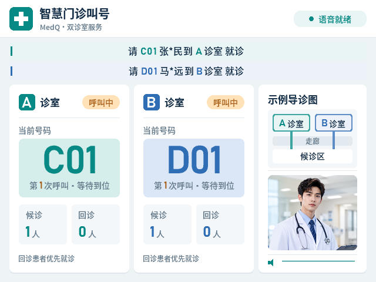

# MedQ 医序 · 智慧叫号与导诊终端

MedQ V0.3 Final 基于安路 EG4S20BG256 FPGA，实现 A、B 双诊室独立叫号、初诊与回诊管理、全名语音播报、隐私字幕和诊室导引。图像与语音素材从 FAT32 TF 卡读取，音视频通过 HDMI 输出。

## 界面

上电显示封面，按 K1–K4 中任意键进入诊室界面。进入按键独立消费，全部按键松开后启用业务操作。右侧提供紧凑诊室地图和单张医生照片轮播，照片以淡出、切换、淡入方式过渡；右下方显示实际 HDMI 音频波形。

## 操作

| 控件 | 功能 |
|---|---|
| K1 / K2 | A / B 诊室初诊取号 |
| K3 / K4 | A / B 诊室回诊取号 |
| SW1 / SW2 | 分别控制 A / B 诊室叫号启停，低电平启用 |
| SW3 / SW4 | 分别控制 A / B 诊室患者到诊及结束事件 |

初诊编号使用 A、B 前缀，回诊使用 C、D 前缀。屏幕显示“请C01张*民到A诊室就诊”，语音播报完整姓名和当前实际编号。两条字幕对应各自诊室，事件触发后居中刷新，随后向左连续循环。

## 工程内容

| 目录 | 内容 |
|---|---|
| rtl/ | 全部 RTL、字库、初始化数据及 IP 配置 |
| tb/ | 全部测试平台、SD 卡与像素参考数据 |
| prj/ | TD 工程、管脚与时序约束、构建和签核脚本 |
| sim/ | 仿真脚本、素材生成工具、回归结果及 RTL 图像 |
| assets/ | 封面、医生照片、名单及 PCM 语音素材 |
| doc/ | 设计说明、接口、操作规范和验证记录 |
| deliverables/ | 已签核位流与 TF 卡根目录文件 |
| rules/、skills/ | 工程配套开发规则、脚本与模板 |

本仓库交付当前版本全部设计与测试源码。历史版本快照、重复压缩包、布局布线数据库和原始逐帧 PPM 属于本机构建归档，未纳入源码分发。

## 部署

1. 将 deliverables/MedQ_v0.3_MEDIA_COVER_20261103T063042Z.bit 下载至开发板。
2. 将 deliverables/TF_CARD_MEDIA_20261103/SD_ROOT/ 内的 **57 个文件**直接复制到 FAT32 TF 卡根目录。
3. 插入 TF 卡，连接 HDMI 显示设备并上电。
4. 封面显示后按任意 K 键进入系统；通过 HDMI 显示设备播放语音。

TF 卡文件为 COVER.BMP、DOC01.BMP、DOC02.BMP 和 CLIP00.PCM 至 CLIP53.PCM。BMP 为 640×480、24 位无压缩格式。原始 JPG、PNG 和试听 WAV 用于素材维护。

## 构建与仿真

环境：Windows、Python 3.10 及以上、Anlogic TD 6.2.168116、ModelSim；图像工具依赖 Pillow。

~~~powershell
python -m pip install -r requirements.txt
python sim/run_regression.py --sim modelsim --timeout 1200
python prj/td/medq_td.py --mode synth
python prj/td/medq_td.py --mode synth --run
~~~

doc/hw/toolchain.json 记录工具路径。按本机安装位置配置后，--mode synth 生成当前目录对应的 TD 工程；加 --run 执行综合。顶层为 rtl/top.v，管脚及时间约束位于 prj/constr/。TD 器件库及仿真库使用本机安装版本。

布局布线与位流构建：

~~~powershell
python prj/td/route_seed.py --parent-result <综合结果result.json路径> --seed 23
python prj/td/signoff_timing.py --result <布局布线结果result.json路径> --bitgen
~~~

设计说明见 [功能规格](doc/spec/media_carousel_20261103.md)，验证记录见 [版本验证记录](doc/compile/media_carousel_delivery.json)。

## 版本验证

| 项目 | 结果 |
|---|---|
| ModelSim 回归 | 55 / 55 通过 |
| PCM 命名与整句语音专项 | 2 项通过 |
| 构建与签核工具测试 | 36 项通过 |
| 双角 setup / hold WNS | +0.225 ns / +0.021 ns |
| 时序违例端点 | 0 |
| LUT / REG | 15268 / 5927 |
| BRAM / DSP | 56 / 17 |
| 目标器件 | EG4S20BG256 |
| 实板测试记录 | board_test: not_tested |

上述结果对应封面、医生轮播及音频波形版。源码 SHA256、位流 SHA256 与逐文件清单见 SOURCE_MANIFEST.json。

## 开源许可

项目原创代码采用 MIT 许可证。厂商 IP、第三方工具模板和媒体素材保留各自权利，适用范围见 [第三方声明](THIRD_PARTY_NOTICES.md)。
